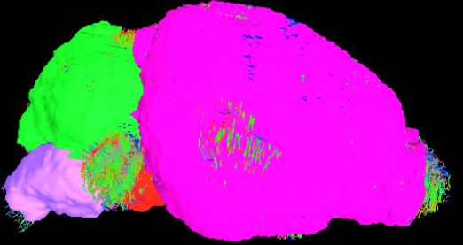

# FibrTraQ

[](https://github.com/castrattonDSU/FibrTraQ/actions/workflows/R-CMD-check.yaml)

FibrTraQ is an analysis package that **assesses and quantifies the spatial extent of connectivity between a specified focal node (fNode) and an unlimited set of connecting nodes (cNodes)**. The primary outputs are in two formats: voxel-wise fNode heatmaps of spatial connectivity to each cNode, and computed region-to-region spatial connectivity (RSC) value tables, which is a percentage of the fNode volume that are connected to each cNode. The data generated by FibrTraQ are suitable for circuit-level, system-level, and global-level assessments of the spatial distribution of connectivity, and are well-suited for comparative analyses across a wide array of contexts. For quality control, a 3D viewer is also generated.

Inputs to the package are very lightweight, needing just a tractogram file (TrackVis `.trk` or MRtrix `.tck`) and binarized NIfTI masks (`.nii` or `.nii.gz`) for the fNode and each cNode. A same-subject, aligned reference image (such as b0, T1, T2 or FA) is optional for execution and recommended for spatial review. Here are the two primary commands within FibrTraQ:

| To analyze | Run | What opens in the report |
|---|---|---|
| One focal region in one subject | `fibrtraq_single()` | That subject’s target maps, connection tables and 3D viewer |
| Several subjects or focal regions | `fibrtraq_study()` | The same results with a subject and focal-region selector |

[Try with sample data](#try-with-sample-data) · [Use your own files](#run-fibrtraq-on-a-single-subject) · [Run a study](#run-a-study) · [Read a target map](#read-the-main-results)

<a id="1-install-fibrtraq"></a>
<a id="install-and-try-the-rudimentary-example"></a>

## Install

Use R 4.0.0 or later. Install the GitHub version from R:

```r
if (!requireNamespace("remotes", quietly = TRUE)) install.packages("remotes")
remotes::install_github("castrattonDSU/FibrTraQ", upgrade = "never")
```

Restart R after installation. For a reproducible study, install the same reviewed tag or commit on each workstation. [Fixed-version installation and local development](https://github.com/castrattonDSU/FibrTraQ/blob/main/docs/advanced-workflows.md#install-a-fixed-version)

<a id="2-verify-the-installation"></a>

## Try with sample data

We've provided the necessary files for one sample mouse brain. This includes the tractogram (trk), 1 fNode (binary NIfTI, green), and 3 cNodes (binary NIfTIs):

<p align="center">
  
</p>

To run FibrTraQ on these data, download the sample data (~80 MB), paste these lines into RStudio after installation, and adjust file paths/names as necessary. We use the cerebellum as the focal node, but this can be adjusted according to interest. fibtraq_single() takes 30-60 seconds to run. You can add `reference_image = file.path(file_dir, "reference-image.nii")` as a line within `fibtraq_single()`, but the grid must be identical. If you don't, a tractogram-derived density image will be used as the background of the sample images instead. You can also reopen the output files and reference images manually in your viewer after running the analysis.

```r
library(FibrTraQ)

file_dir    <- "path/to/files"

targets <- c(
  cerebrum = file.path(file_dir, "sample-cerebrum.nii.gz"),
  pontine = file.path(file_dir, "sample-pontine.nii.gz"),
  medullaspinal = file.path(file_dir, "sample-medullaspinal.nii.gz")
)

analysis <- fibrtraq_single(
  subject = "sample", focal_label = "cerebellum",
  tractogram = file.path(file_dir, "sample-tractogram.trk"),
  focal_mask = file.path(file_dir, "sample-cerebellum.nii.gz"),
  target_masks = targets,
  output_dir = "path/to/output",
  open = TRUE
)
```

This will open a report.html that displays an RSC summary table, as well as sample screenshots of the spatial streamline density heatmap and connection density heatmaps (per cNode) across the fNode. There is also a streamline fate summary, downloadable `.csv`s, QC checks, a voxel coverage summary table, and a series of screenshots containing exploratory analyses. 

## Run FibrTraQ on a single subject

To run FibrTraQ on local data, simply adjust the file paths from the code above. You can use any number of targets (cNodes). 

To check these inputs first, add `check_only = TRUE` to the same call. The check reads inputs without counting streamlines or writing the results folder. Version `0.3.5.9003` adds a check of the automatic TRK mapping before counting streamlines or writing the results folder. `axis_flip = c(FALSE, FALSE, FALSE)` can be used to override this check in case of errors. We suggest verifying anatomical alignment separately, but caution that various viewing software can treat header data differently. If you omit the reference image, the report can use a tractogram-density background. [Spatial verification](https://github.com/castrattonDSU/FibrTraQ/blob/main/docs/spatial-verification.md)

For MRtrix, supply the `.tck` filename in `tractogram`. Its world coordinates use the NIfTI affine. Keep `track_space = "auto"` or `"world"` and leave `axis_flip` unset. For TrackVis (`.trk`), verify the exporter's coordinate convention against the anatomy. [TCK input requirements](https://github.com/castrattonDSU/FibrTraQ/blob/main/docs/advanced-workflows.md#mrtrix-tck-inputs)

<a id="looping-across-subjects"></a>
<a id="run-a-regional-study"></a>

## Run a study

Make a copy the study-sheet template: [Study sheet template](inst/examples/study-sheet.csv). Save it to your study folder as `study-sheet.csv` and edit it:

Each row identifies one subject. Use the exact tractogram filename and one `mask:<region>` column per region. The `reference_image` column is optional. File paths in the sheet are relative to the CSV’s folder or absolute. Keep IDs such as `001` as text when editing in a spreadsheet. At this stage, you might consider separating by cohort.

First, run the pre-flight check on the subjects and regional masks together:

```r
library(FibrTraQ)

sheet <- "/absolute/path/to/study/study-sheet.csv"
results_dir <- "/absolute/path/to/new-cohort-results"

checked <- fibrtraq_study(
  study_sheet = sheet, focal_regions = "cerebellum",
  output_dir = results_dir, check_only = TRUE
)
print(checked$index)
stopifnot(checked$passed)
```

Read `checked$checks` for the subject, focal region and reason. A missing file needs a corrected path. If automatic TRK mapping proposes a reflection, verify the mapping for those inputs and supply the supported settings in both calls. Review any warnings even when `checked$passed` is `TRUE`. After checking alignment, run the study:

```r
study <- fibrtraq_study(
  study_sheet = sheet, focal_regions = "cerebellum",
  output_dir = results_dir, open = TRUE
)
```

The report has one cerebellum analysis per subject. Omit `focal_regions` to use every supplied region as the focal region in turn. Both commands use the active focal mask as the local region by default. To reproduce the regional study default from 0.3.5, specify `local_masks = "union"`. The choice affects local and fate summaries. Existing R workflows can also supply named vectors and lists directly. [Study inputs and local-mask settings](https://github.com/castrattonDSU/FibrTraQ/blob/main/docs/advanced-workflows.md#regional-study-input-structure)

<a id="what-fibrtraq-writes"></a>
<a id="interpret-results-correctly"></a>

## Read the main results

**Target NIfTI maps contain unweighted streamline counts.** With the defaults, a value of `3` at a cerebellar voxel in `*_target-medullaspinal.nii.gz` means that three distinct streamline records visited that focal voxel and also reached the medullaspinal mask. Returning to the same focal voxel or entering the target twice still contributes one. A streamline visiting two focal voxels contributes to both, and one reaching two destinations can contribute to both destination maps. Voxels outside the focal mask are zero.

By default, visits are determined from the stored tractogram points. Sparse streamlines may cross a voxel between points without recording a visit there. `streamline_voxelization_mode = "segment_interpolation"` also samples along the connecting segments. Selecting an endpoint assignment rule or `focal_assignment_mode = "first_intersection"` changes which connections or focal voxels receive a count. The report’s methods and run metadata record these choices. [Counting and interpretation](https://github.com/castrattonDSU/FibrTraQ/blob/main/docs/interpretation.md)

**Region-to-region spatial connectivity (RSC)** is the percentage of all focal voxels with a positive count for a destination. Focal voxels with zero assigned streamlines stay in the denominator. Multiple targets can reach the same focal voxel, so their percentages can sum to more than 100%. For the number of *distinct streamlines* connected to a target across the entire focal region, use **Unique streamline connections** in the report.

### What to open or share

After a run, R prints **Open this report** with the HTML path and **Share this folder** with the full output folder path. The examples open the report automatically. The destination table links each target to its NIfTI map when maps are generated. Use the subject and focal-region selector in a multi-analysis study. Select **3D QC viewer** to inspect sampled streamlines.

| Inside each subject/focal-region folder | Contents |
|---|---|
| `figures/` | PNG figures and the viewer’s data |
| `maps/` | NIfTI images, including one count map per destination |
| `tables/` | Complete voxel counts, rankings, target lookup and summaries |
| Metadata and validation JSON | Input files, settings and checks |

Zip the entire **Share this folder** directory. The recipient should extract the ZIP before opening the HTML so the figures, tables and viewer load together. The two CSVs at the output root record the run index and prepared inputs. Metadata can include original file paths. [Output inventory](https://github.com/castrattonDSU/FibrTraQ/blob/main/docs/advanced-workflows.md#what-fibrtraq-writes) · [Field definitions](inst/output-guide/OUTPUTS_README.md)

## Common problems

| Symptom | What to check |
|---|---|
| Command missing in R | Restart R and check the loaded version and source revision with `packageDescription("FibrTraQ")`. |
| Automatic TRK mapping proposes an axis flip | The first 200 streamlines (or fewer in a smaller file) gave a reflected mapping the best score. The run stopped before counting. Verify alignment before setting `track_space` and `axis_flip`. [Harmonized mouse controls](https://github.com/castrattonDSU/FibrTraQ/blob/main/docs/mouse-study-workflow.md#orientation-for-the-six-harmonized-controls) |
| Input grids disagree or focal hits are absent | Check subject identity, mask content, voxel dimensions and NIfTI affines. A 4-D reference also requires one b-value per volume. |
| File or report fails to open on Windows | Extract the complete folder into a short location such as `C:/FibrTraQ/run01`. |
| Anatomical endpoint QC is unavailable | Supply trusted, same-grid binary endpoint-context masks to assess anatomical containment. |

For the complete arguments, use `?fibrtraq_single` or `?fibrtraq_study`. For support, include the package version, operating system, exact error and a minimal example. [GitHub issues](https://github.com/castrattonDSU/FibrTraQ/issues)

## Validation, citation and license

The bundled fixture and automated tests check coordinate mapping, counting, format handling and agreement between the R and C++ implementations. Each research dataset requires independent verification of spatial alignment and tractography quality. [Validation record](https://github.com/castrattonDSU/FibrTraQ/blob/main/VALIDATION.md)

Cite the package with `citation("FibrTraQ")`. [Citation](https://github.com/castrattonDSU/FibrTraQ/blob/main/CITATION.cff)

FibrTraQ and its bundled synthetic data are licensed under the GNU General Public License, version 2 or later. Earlier releases distributed under MIT retain their original license, including `v0.3.0-rc2`. Dependencies keep their own licenses. [License](https://github.com/castrattonDSU/FibrTraQ/blob/main/LICENSE.md) · [Contributing](https://github.com/castrattonDSU/FibrTraQ/blob/main/CONTRIBUTING.md) · [Support](https://github.com/castrattonDSU/FibrTraQ/blob/main/SUPPORT.md)
